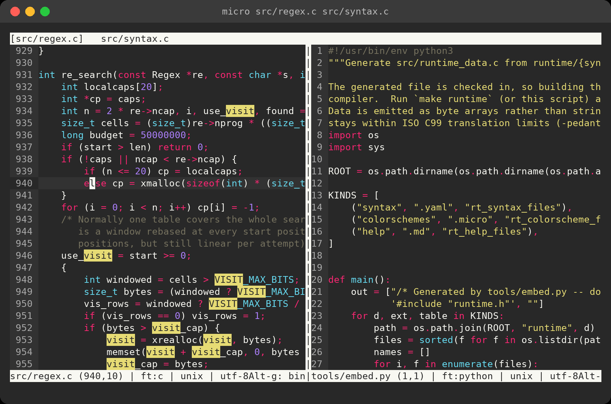

# cmicro: micro, rewritten in C

The [micro](https://github.com/micro-editor/micro) terminal text editor,
rewritten from scratch in [Universal C](https://github.com/v3ai/universal-c)
with no dependencies: C89 that compiles unchanged as C89, C99, C11, C17 and
C23. Same keys, commands, settings, syntax highlighting and colorschemes as
micro. Runs on Linux, macOS, the BSDs, WSL and Cygwin.



```
./build.sh
./micro file.c
```

## About

micro is a modern, intuitive terminal editor: Ctrl-S saves, Ctrl-Q quits,
Ctrl-C/Ctrl-V copy and paste, and the mouse just works. The original is
written in Go. cmicro is a full reimplementation in portable C that needs
nothing but a C compiler and the C library. It builds in seconds into a
single ~700 KB executable with every syntax file and colorscheme built in.

It aims to feel exactly like micro. If you already use micro, your
`settings.json` and `bindings.json` work as they are, and the key bindings,
commands, options and highlighting behave the same way. If you don't, press
Ctrl-G inside the editor for help.

Highlights:

- **Same editor:** micro's default key bindings, ~130 actions, command bar
  with completion and history, all of its options, and its settings and
  bindings file formats
- **Highlighting:** micro's ~160 syntax definitions and 25 colorschemes,
  embedded, using micro's highlighting algorithm, in 16, 256 or 24-bit color
- **Editing:** splits, tabs, multiple cursors, macros, undo/redo, regex
  find and replace, softwrap, mouse support, system clipboard
- **Safety:** crash-recovery backups, reload prompts when a file changes
  on disk, saving through sudo on permission errors
- **Everything from scratch:** its own regular-expression engine (Go/RE2
  syntax, tested against Go's), YAML and JSON parsers and terminal renderer
- **Portable:** everything but one small POSIX file is Universal C: no
  compiler extensions, no undefined or implementation-defined behavior, and
  the same output with signed or unsigned `char` and on big-endian systems

Not included: micro's Lua plugin system, its built-in terminal emulator and
the git diff gutter.

## Download

Prebuilt binaries are on the
[Releases](https://github.com/v3ai/cmicro/releases) page:

- `micro-linux-x86_64`: statically linked Linux build
  (`chmod +x micro-linux-x86_64`).

Or build it yourself; see below.

## Building

Requirements: any C compiler for C89 or later and a POSIX shell, on a
POSIX system (Linux, macOS, the BSDs, WSL, Cygwin). No make, no configure.

```
./build.sh            # builds ./micro
./build.sh test       # runs the formatter test and compiles/runs every regex
./build.sh check      # Universal C conformance (see below)
./build.sh install    # installs to /usr/local/bin (PREFIX=... to change)
./build.sh clean      # removes build outputs
./build.sh runtime    # re-embed runtime/ files after editing them (needs python3)
```

`CC`, `CFLAGS` (default `-O2`), `LDFLAGS`, `PREFIX` and `DESTDIR` are taken
from the environment, e.g. `CC=clang CFLAGS="-O2 -g" ./build.sh`. The build
uses `-std=c89 -Wall -Wextra -pedantic` and takes a few seconds; one
compiler command does the same:

```
cc -O2 -o micro src/*.c
```

### Windows

Native Windows support has been removed. On Windows, run cmicro inside
[WSL](https://learn.microsoft.com/windows/wsl/) or Cygwin, where it builds
and behaves exactly as on Linux.

## Universal C

cmicro follows the [Universal C](https://github.com/v3ai/universal-c) rules:
code that compiles on every conforming C compiler from C89 through C23 and
behaves the same on every platform. Concretely:

- **C89 dialect, any standard.** Every file compiles with zero warnings
  under gcc and clang with `-std=c89`, `c99`, `c11`, `c17` and `c2x`,
  `-pedantic-errors -Werror` and the strict warning set (`-Wconversion`,
  `-Wsign-conversion`, `-Wshadow`, `-Wformat=2`, ...).
- **C89 library only.** No `snprintf`, `long long`, `stdint.h` or other
  later additions outside `src/port.h`. Formatting goes through
  `cm_str_vprintf`, a small C89 replacement for `vsnprintf`; numbers are
  parsed with a clamped `strtol` wrapper instead of `atoi`.
- **One portability header.** `src/port.h` is copied unchanged from the
  standard; it provides exact-width types (`p_u32`, `p_s64`), static
  assertions and the only compiler- and version-specific `#if`s.
- **No undefined or implementation-defined behavior relied on.** Bit
  operations are on unsigned types, conversions are range-checked, `<ctype.h>`
  arguments are cast to `unsigned char`, layout and size display use integer
  arithmetic, and the output is the same with signed or unsigned `char` and
  on big-endian machines.
- **Translation limits.** No string literal over 509 characters, no object
  over 32767 bytes (runtime files are embedded as byte arrays, one per file).
- **Names.** Every external symbol has the `cm_` prefix, and no identifier
  is a keyword or reserved name of any C standard or C++.

The only file that goes beyond the C89 library is `src/platform.c` (see
below), as the rules allow for things ISO C cannot do. The editor states
two assumptions explicitly, both guaranteed by POSIX: `int` has at least 32
bits and a 64-bit integer type exists (`P_HAS_64`); the build fails
otherwise.

`./build.sh check` runs `tools/check.sh`, which verifies all of this:

1. the compile matrix above, for every source and test file;
2. a scan for constructs `-std=c89` lets through (C95 headers, trigraphs,
   headers outside the C89 library);
3. builds of the tests and the editor that must all print identical output:
   native, AddressSanitizer + UndefinedBehaviorSanitizer, MemorySanitizer,
   unsigned and signed plain `char`, 32-bit (`-m32`) and big-endian s390x
   under QEMU. Configurations whose tools are missing are skipped and
   listed.

## The platform layer

ISO C has no notion of a terminal. Raw keyboard input, the window size,
resize notification, directory listings (for tab completion) and
millisecond clocks don't exist in the standard library. Those calls are
isolated behind the small interface in `src/platform.h`, implemented for
POSIX (termios, ioctl, poll, opendir, stat, realpath) in `src/platform.c`.

Every other file includes only C89 standard headers.

Things micro gets from Go's standard library or third-party packages are
implemented here directly:

| micro uses                         | this rewrite                                   |
|------------------------------------|------------------------------------------------|
| Go `regexp` (RE2)                  | `src/regex.c`: RE2-syntax engine, backtracking VM with a visited-state table (linear time) |
| `yaml.v2` for syntax files         | `src/conf.c`: YAML subset parser                |
| `json5` for settings/bindings      | `src/conf.c`: lenient JSON (comments, trailing commas) |
| `tcell` terminal library           | `src/screen.c` + `src/input.c`: diffing cell renderer, escape-sequence decoder, SGR mouse, bracketed paste, 256/truecolor |
| `go-runewidth`                     | `src/util.c`: East-Asian-wide / combining tables |
| Lua plugins `autoclose`, `comment`, `ftoptions`, `status` | built in natively |
| `os/exec` for shell commands       | ISO C `system()`                               |
| `fmt.Sprintf`                      | `src/util.c`: C89 formatter (`cm_str_vprintf`)  |

## Feature coverage

Implemented as in micro:

- All default buffer and command-bar key bindings, `bindings.json`
  (including `buffer`/`command` sections, `command:` and `command-edit:`
  actions, and `,` `|` `&` action chaining), `bind`/`unbind`/`showkey`/`raw`
- Every buffer action micro has (≈130): word/subword motion, paragraphs,
  selection, line moves, duplicate, cut-line accumulation, indent/outdent,
  word autocomplete, overwrite mode, matching brace, macros, and more
- Multiple cursors (Alt-n, Alt-Shift-Up/Down, Alt-m, Alt-p, Alt-c, Alt-x,
  Ctrl-click)
- Undo/redo with micro's 1-second grouping; modified tracking that becomes
  clean again when you undo back to the saved state
- Find (regex and literal, incremental, `hlsearch`), FindNext/Previous with
  wrap-around, `replace` (interactive y/n/esc) and `replaceall` with `$1`
  submatches and selection-limited replacement
- Commands: set, setlocal, toggle, togglelocal, reset, show, showkey, run,
  bind, unbind, quit, goto, jump, save, replace, replaceall, vsplit, hsplit,
  tab, tabmove, tabswitch, help, log, reload, reopen, cd, pwd, open, retab,
  raw, textfilter, memusage, comment, with tab completion and history
- All of micro's options (see `help options`), `settings.json` with
  `ft:` and glob sections, saving on `set`
- Syntax highlighting using micro's region/pattern algorithm and filetype
  detection (filename, header, signature)
- Colorschemes (`color-link`, `include`, attributes, 16/256/hex colors)
- Vertical/horizontal splits, tabs, tab bar, status line format strings,
  info bar, key menu (Alt-g), help pages (Ctrl-g)
- Softwrap and wordwrap with visual-line cursor movement, horizontal scrolling,
  ruler/relative ruler, cursor line, color column, scrollbar, `showchars`
- Mouse: click, double-click word, triple-click line, drag-select, wheel,
  Ctrl-click for cursors, click to switch tabs and splits
- Clipboard: internal, external tools (wl-copy, xclip, xsel, pbcopy) or OSC 52
- Crash-recovery backups with micro's recover/ignore/abort prompt,
  `savecursor`, `autosave`, reload prompt when the file changes on disk,
  save-with-sudo on permission errors, `eofnewline`, `rmtrailingws`,
  `mkparents`, DOS line endings, UTF-8 BOM, reading from a pipe
  (`ls | micro`), `+LINE:COL` and `file:LINE:COL`

Not implemented, because they need a Lua interpreter or a full terminal
emulator: Lua plugins and the plugin manager (`plugin`, `eval`), the `term`
command, the git `diffgutter`, the linter plugin, `saveundo`, and encodings
other than UTF-8. Those options and commands are accepted and give a clear
message.

## Layout

```
build.sh         builds, tests, checks and installs (POSIX sh)
src/port.h       Universal C portability header (from the standard, unchanged)
src/platform.c   POSIX terminal/filesystem glue (the only non-C89 file)
src/main.c       command line, startup, main loop
src/editor.c     editor state, tabs, event dispatch, frame rendering
src/actions.c    every bindable action, typing, clipboard, search, macros
src/bindings.c   default bindings, bindings.json
src/commands.c   command bar commands, completion, replace, help
src/prompt.c     info-bar prompts, history, completion UI
src/render.c     panes, status line, tab bar, info bar
src/pane.c       cursors, softwrap geometry, scrolling
src/tabs.c       split tree layout
src/buffer.c     text storage, file I/O, undo/redo, highlight state
src/backup.c     crash backups, savecursor, sudo save
src/syntax.c     syntax definitions and highlighter
src/colors.c     colorschemes
src/regex.c      regular expression engine
src/conf.c       YAML and JSON parsers/writers
src/screen.c     cell grid + ANSI output
src/input.c      key/mouse/paste decoding, key names
src/options.c    option table, settings.json
src/util.c       strings, C89 formatter, UTF-8, paths, allocation
src/runtime*.c   embedded runtime files (generated by tools/embed.py)
runtime/         micro's syntax files and colorschemes (MIT), help pages
tests/           formatter and regex tests, pty test harness (term.py)
tools/check.sh   Universal C conformance checks (./build.sh check)
tools/screenshot.py  regenerates docs/screenshot.png (needs pyte, pillow)
```

## Testing

- `./build.sh test` checks the C89 formatter against fixed expected output, and
  compiles all 3,794 regular expressions from micro's syntax files with the
  built-in engine and runs each over its syntax file, printing a hash of
  every match position.
- `./build.sh check` runs the Universal C checks described above; the test output
  (including that hash) must be identical in every configuration. The
  formatter was also differential-tested against glibc's `snprintf`
  (36,800 format/argument combinations, identical).
- The regex engine is differential-tested against Go's `regexp`: every
  bundled syntax pattern against 365 sample lines (53,328 lines of match and
  capture output) is identical, plus ~1.3M randomly generated RE2 patterns.
  Long lines are handled in linear time (e.g. a match after 3 MB of text).
- `tests/term.py` drives the editor in a pseudo-terminal (via `pyte`) for
  end-to-end tests of editing, prompts, splits, tabs, mouse, paste, resize,
  softwrap, config files and crash recovery.
- The editor was run under AddressSanitizer and UndefinedBehaviorSanitizer
  with scripted scenarios and randomized key/mouse/paste fuzzing, and the
  code was reviewed independently against micro's Go source; the issues
  found were fixed and their reproductions re-run clean.
- The Universal C version was checked against the previous C99 build with
  a scripted pseudo-terminal session (splits, tabs, search, replace, undo,
  multiple cursors, mouse, softwrap, colorschemes, help, shell filters,
  resize): all 43 screens, including cursor position and colors, are
  identical natively, with unsigned `char`, and on big-endian s390x under
  QEMU, and the session runs clean under AddressSanitizer and
  UndefinedBehaviorSanitizer.
- Highlighting long minified lines is linear: a 620 KB single-line
  JavaScript file highlights in about half a second.

Known small differences: case-insensitive search folds ASCII letters only,
and Unicode classes such as `\pL` are approximated by code-point ranges.

## License

cmicro is released under the MIT License (see `LICENSE`).

It is a reimplementation of micro, which is also MIT licensed (see
`LICENSE-micro`). The syntax files and colorschemes in `runtime/` come from
micro and keep their licenses (`runtime/syntax/LICENSE`).
